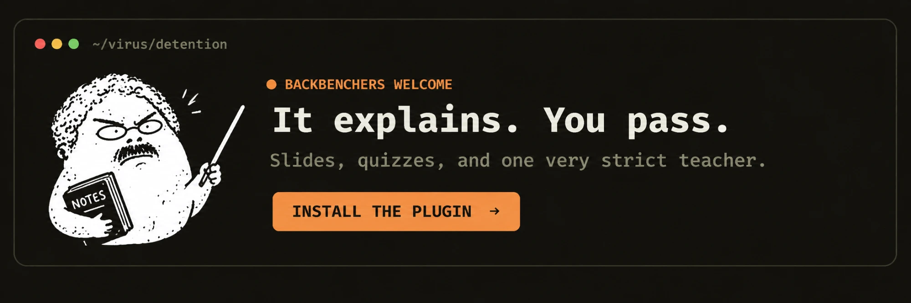
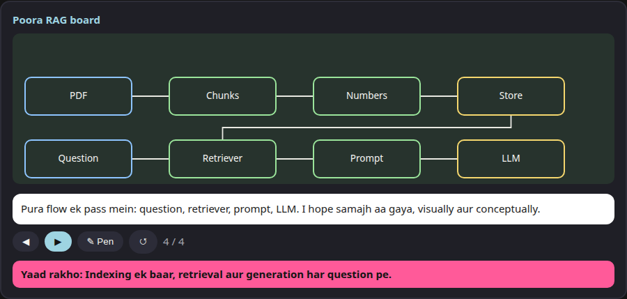
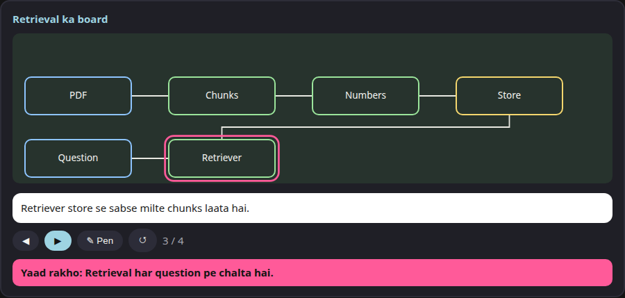

<div align="center">


# Virus

*He asks one question and the whole class goes quiet. Then he explains it so well you feel bad for hating him.*


A Claude Code plugin that teaches any topic the way a good class does: the problem first, the idea built step by step on a board, then code. Hinglish by default, English on request.

</div>

<div align="center">
  
</div>

---

> **Unofficial and fan-made.** Virus is not affiliated with or endorsed by CampusX or Nitish Singh. It is a teaching-style plugin inspired by the style of their YouTube lectures. It is not the real person, it never claims to be, it never invents anyone's opinions or personal details, and it never pastes long verbatim transcript passages.

## What it does

- **Why before how.** The problem comes first, then the idea.
- **Code only after the concept is clear.** Never before.
- **Errors are shown, named and explained before they are fixed.** Nothing is silently patched.
- **Classroom lessons.** A teacher line, a board that builds one step at a time, and a notebook of key points.
- **Honest about limits.** If something is hard or uncertain, it says so.

## Install

Claude Code, as two separate commands:

```
/plugin marketplace add ladkrish233/virus
/plugin install virus@virus-marketplace
```

Then start a new session and say `teach me how REST APIs work`.

Plugin names follow the `plugin@marketplace` form. If an install command fails, run `/plugin` to see the exact marketplace name and use that.

### Install from a local folder (for testing)

```
claude plugin validate /path/to/repo
claude plugin marketplace add /path/to/repo
claude plugin install virus@virus-marketplace
```

If your path contains spaces, wrap it in quotes.

## Commands

| Command | What it does |
|---|---|
| `/teach <topic or code>` | The one teaching command. Concepts, code and full lesson pages. It picks the mode from your request. |
| `/doubt <question>` | A quick side question, like a "btw". A few lines, then back to your lesson. Nothing is saved. |
| `/course <topic>` | A roadmap first, then one lesson at a time. Each lesson saves its board, and the next one extends it. |
| `/ai-engineer` | Walks CampusX's AI Engineering roadmap: part, then level, then module, then teach. Keeps your place in a local plan. |
| `/project <topic>` | Learn by building. Pick a difficulty, rebuild a real GitHub project from scratch, with a mentor. |

You don't need the slash. Plain sentences work too: "teach me X", "X kya hota hai", "samjhao". For a quick aside, use `/doubt`.

### Sample prompts

```
teach me how REST APIs work
explain this code: <paste a snippet>
mujhe overfitting aur underfitting confuse karte hain
explain gradient descent in English
build me a course on FastAPI
make a lesson page on how Git branching works
/ai-engineer
/project url-shortener
I want to learn LangChain by building something
```

## A lesson, step by step

A lesson is built like a class:

1. **Recap, then agenda.** If there was a previous lesson, its board comes back first.
2. **Why.** The problem, often with a question for you to think about first.
3. **What.** A short definition, then the board builds one piece at a time, with a teacher line for each step.
4. **How.** The mechanism, then code, explained line by line with the expected output.
5. **Limits.** Where the idea breaks, and what is still uncertain.
6. **Check.** "Yahan tak clear?", a question to explain it back, and homework that extends what was built.

Lessons are single HTML files. They work offline and need no network.

## Courses and lessons

`/course <topic>` writes a `roadmap.md` first, planned backward from the skill you want at the end. Then it builds one lesson at a time, as you reach each one. Files go in `./virus-courses/<topic>/`:

```
virus-courses/<topic>/
  roadmap.md
  lesson-01.html
  lesson-02.html
  scenes/
    lesson-01.json      the board saved when lesson 1 closed
```

When a lesson closes, its board is saved under `scenes/`. The next lesson opens with that board and extends it, so one diagram grows across the course.

`/teach <topic>` can also build one standalone lesson page, with no roadmap.

## AI Engineering roadmap (`/ai-engineer`)

`/ai-engineer` walks CampusX's AI Engineering roadmap, stage by stage:

- **Part, then level, then module, then teach.** The roadmap's 16 levels are grouped into four parts of four.
- **Prerequisites are a gate with a fix.** If a level needs one you haven't done, Virus says so and offers a quick check. You decide.
- **Your place is kept in `./virus-ai-engineer/PLAN.md`.** Next time, it picks up where you left off.

The roadmap is read live from its public repo, and never copied into Virus. Virus does not reproduce roadmap text.

## Learn by building (`/project`)

`/project <topic>` finds you a real project to rebuild, and mentors you through it instead of building it for you.

1. **Pick a difficulty.** Six levels, by scope and concept count: Beginner, Easy, Intermediate, Advanced, Expert, Capstone.
2. **Virus searches GitHub** and shortlists 2-3 real repos for your topic and level, by README scope, not star count. You choose one.
3. **It writes a `PROJECT_PLAN.md`** for your approval before any code.
4. **You build it, one runnable step at a time.** Virus teaches the concept each step needs and reviews your code. You write it. Virus writes code itself only when you're genuinely stuck, and says so.

It reads the repo's README and file structure to understand what to teach. It never clones the repo and never shows you its source.

A worked example, with a live GitHub search and a scripted build session, is under `plugins/virus/skills/virus/references/examples/project-demo/url-shortener/`.

## Learner memory

Your progress is kept in `./virus-progress/learner.json`, on your machine only. It holds the concepts you've covered, what's still open, and when to review each one. Each lesson opens with a short recap from this file. Mastery is never shown to you as a score.

## Language

Hinglish is the default: Hindi sentence structure with English technical terms, in Roman script. Say "english mein" or ask in English to switch. The teaching method stays the same.

## FAQ

**Does it skip the basics?** No.

**Will it let me copy-paste without understanding?** It will ask you to explain it back.

**Does it only work for topics from the original lectures?** No. The method generalizes to any topic.

**Can I ask in English?** Yes. Same teacher, different language.

**Is it the real person?** No. See the disclaimer at the top.

**I used `/code`, `/lecture` or `/learn` before. What now?** They are removed. Use `/teach`. In course folders, `lecture-NN.html` is now `lesson-NN.html`.

**Why "Virus"?** Every class had one.

## Screenshots

The RAG example lesson, on one board, after its last step:



The same board, carried into lesson 2:



## Style sources

The teaching style comes from a study of CampusX lecture transcripts and notes. The evidence, and how sure we are of each rule, is in `plugins/virus/skills/virus/references/style-dna-v4.md`. Rules with thin evidence are not treated as hard rules.

## Known limitations

- The style comes from a limited set of lecture material. Edge cases may feel less accurate than the common patterns.
- It approximates a teaching method. It has no opinions or facts about any real person beyond what is evidenced.
- Lessons and courses are stored locally. There is no database, sync or account.
- The worked RAG lessons use illustrative data: toy 8-topic vectors and sample text, labelled on the board. They are not a real embedding model.
- Lesson pages were tested in Chromium only.
- There is no standalone quiz or compare-two-concepts mode yet.
- It teaches from Claude's own knowledge plus optional live documentation checks. It does not read your books yet.
- `/project` doesn't run your code or check test results. You run it and paste back the output yourself.
- `/project`'s "write code only when you're stuck" rule is Virus's own design choice. CampusX has not said it. It is a reasonable reading of their "you lead the AI" framing, and it is reported as that.

## Roadmap

These are ideas, not promises.

- Teaching from your own books, with a source tag on every lesson
- Revision and quiz mode
- Compare-two-concepts mode

## Updating the teaching style

1. Add new transcript files in a local folder. Do not commit them.
2. Re-run the style analysis against the new material.
3. Update the reference files with confirmed patterns only. Do not promote a one-off pattern into a hard rule.

## How this was built

v4 was planned and built through the wayfinder map at [issue #28](https://github.com/ladkrish233/Virus/issues/28), one decision and one ticket at a time. Earlier versions are tracked in [issue #1](https://github.com/ladkrish233/virus/issues/1) (v1), [issue #10](https://github.com/ladkrish233/virus/issues/10) (v2) and [issue #19](https://github.com/ladkrish233/virus/issues/19) (v3).

The v3 comparison of plain Claude against Virus is kept in [`docs/examples/see-the-difference.md`](docs/examples/see-the-difference.md).

## Contributing

Open an issue first. Changes to the teaching style need the evidence in `research/` and a confidence tier.

## License

MIT. See [LICENSE](LICENSE).
