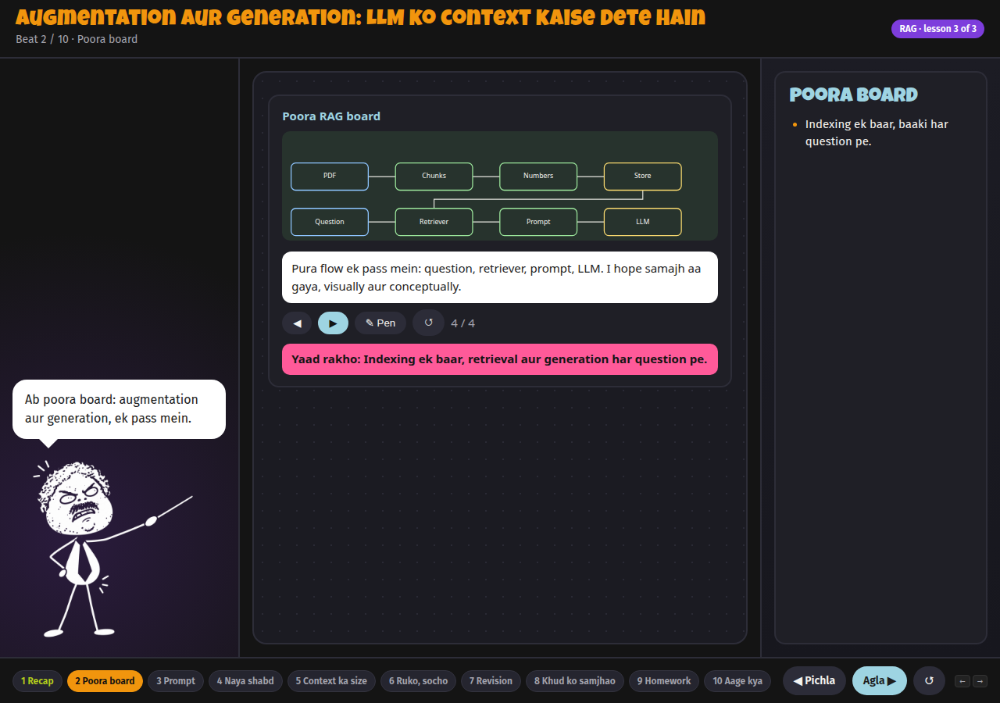
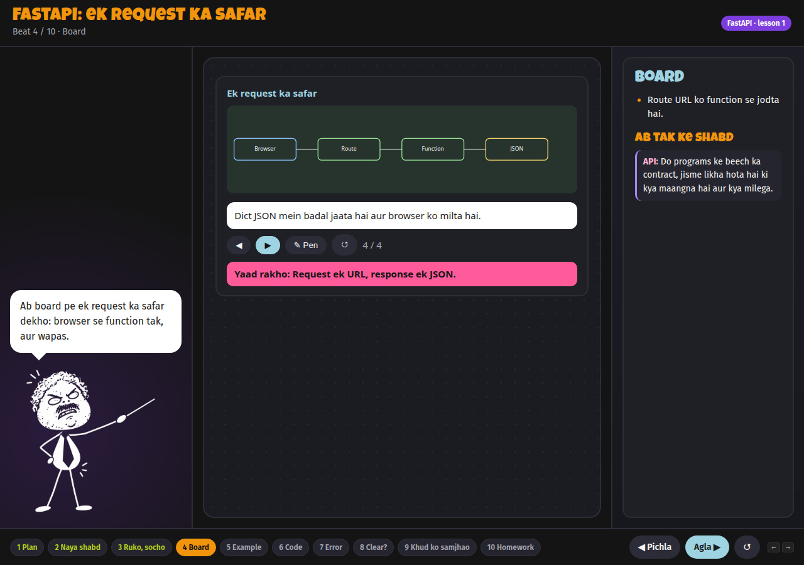

<div align="center">


# Virus

**A Claude Code plugin that teaches like a good class.** The problem first, then the idea built step by step on a board, then the code. Hinglish by default, English on request.


</div>

> **Unofficial and fan-made.** Virus is not affiliated with or endorsed by CampusX or Nitish Singh. It is a teaching-style plugin inspired by their YouTube lectures. It is not the real person, never claims to be, never invents anyone's opinions or personal details, and never pastes long transcript passages.

---

## Why Virus

Most AI answers hand you the finished thing. Virus makes you understand it first.

- **Why before how.** The problem comes first, then the idea.
- **Code after the concept.** Never before.
- **Errors are named, not hidden.** Each one is shown and explained before it is fixed.
- **A classroom, not a chat.** A teacher line, a board that builds one step at a time, and a notebook of key points.
- **Honest about limits.** When something is hard or uncertain, it says so.

## Install

```
/plugin marketplace add ladkrish233/virus
/plugin install virus@virus-marketplace
```

Start a new session and say `teach me how REST APIs work`.

If an install command fails, run `/plugin` to see the exact marketplace name.

<details>
<summary>Install from a local folder (for testing)</summary>

```
claude plugin validate /path/to/repo
claude plugin marketplace add /path/to/repo
claude plugin install virus@virus-marketplace
```

Wrap the path in quotes if it contains spaces.

</details>

## Commands

| Command | What it does |
|---|---|
| `/teach <topic or code>` | The one teaching command. Concepts, code and full lesson pages. It picks the mode from your request. |
| `/doubt <question>` | A quick side question, like a "btw". A few lines, then back to your lesson. Nothing is saved. |
| `/course <topic, docs URL, or AI-engineer level>` | A roadmap first, then one lesson at a time. Each lesson saves its board, and the next one extends it. |
| `/ai-engineer` | Walks CampusX's AI Engineering roadmap: part, then level. Pick a level and it builds a course on it. |
| `/project <topic>` | Learn by building. Pick a difficulty, rebuild a real GitHub project from scratch, with a mentor. |

You don't need the slash. Plain sentences work too:

```
teach me how REST APIs work
X kya hota hai
samjhao: gradient descent
explain this code: <paste a snippet>
build me a course on FastAPI
I want to learn LangChain by building something
```

## See the difference

Plain Claude gives you a definition. Virus gives you a lesson.

**Prompt:** `teach me how REST APIs work`

> **Claude alone:** "REST is an architectural style. A REST API exposes resources via URLs and uses GET, POST, PUT and DELETE. It is stateless, and responses are usually JSON."

> **Virus (English):** "Let's get into REST APIs. First the problem: a mobile app and a website both need the same user data. If each talks straight to the database, a change to the database breaks code in two places. The fix is a middle layer, the API. Think of a restaurant: you are the customer, the API is the waiter, the kitchen is the backend. Now tell me: to update a user's data, GET or PUT?"

More side-by-side samples, for every command, are in [`docs/examples/see-the-difference.md`](docs/examples/see-the-difference.md).

## How a lesson works

A lesson is built like a class:

1. **Recap, then agenda.** If there was a previous lesson, its board comes back first.
2. **Why.** The problem, often with a question for you to think about first.
3. **What.** A short definition, then the board builds one piece at a time, with a teacher line for each step.
4. **How.** The mechanism, then code, explained line by line with the expected output.
5. **Limits.** Where the idea breaks, and what is still uncertain.
6. **Check.** "Yahan tak clear?", a question to explain it back, and homework that extends what was built.

Lessons are single HTML files. They work offline and need no network.

## Courses

`/course` writes a `roadmap.md` first, then builds one lesson at a time, as you reach each one:

```
virus-courses/<topic>/
  roadmap.md
  lesson-01.html
  lesson-02.html
  scenes/
    lesson-01.json      the board saved when lesson 1 closed
```

When a lesson closes, its board is saved under `scenes/`. The next lesson opens with that board and extends it, so one diagram grows across the course.

`/teach <topic>` can also build one standalone lesson page, with no roadmap.

## AI Engineering roadmap (`/ai-engineer`)

`/ai-engineer` walks CampusX's AI Engineering roadmap:

- **Four parts, sixteen levels.** Levels L0–L15, grouped into four parts of four.
- **A course per level.** Pick a level and say you want to learn it. Virus builds `roadmap.md` and one lesson per module, in `./virus-courses/ai-engineer-l<N>-<slug>/`.
- **One module at a time.** Or teach a single module with `/teach`.
- **Local files.** The roadmap is read from the 16 `.txt` files in `plugins/virus/skills/virus/references/ai-engineer-roadmap/`. Nothing is fetched live.

## Learn by building (`/project`)

`/project <topic>` finds a real project to rebuild, and mentors you through it instead of building it for you.

1. **Pick a difficulty.** Beginner, Easy, Intermediate, Advanced, Expert, or Capstone.
2. **Virus searches GitHub** and shortlists 2–3 real repos by README scope, not star count. You choose one.
3. **It writes a `PROJECT_PLAN.md`** for your approval before any code.
4. **You build it, one runnable step at a time.** Virus teaches what each step needs and reviews your code. Virus writes code itself only when you're genuinely stuck, and says so.

It reads the repo's README and file structure. It never clones the repo and never shows you its source.

A worked example is in `plugins/virus/skills/virus/references/examples/project-demo/url-shortener/`.

## Learner memory

Progress is kept in `./virus-progress/learner.json`, on your machine only. It holds the concepts you've covered, what's still open, and when to review each one. Each lesson opens with a short recap from it. Mastery is never shown as a score.

## Language

Hinglish is the default: Hindi sentence structure with English technical terms, in Roman script. Say "english mein" or ask in English to switch. The teaching method stays the same.

## FAQ

**Does it skip the basics?** No.

**Will it let me copy-paste without understanding?** It will ask you to explain it back.

**Does it only work for topics from the original lectures?** No. The method generalizes to any topic.

**Is it the real person?** No. See the disclaimer at the top.

**I used `/code`, `/lecture` or `/learn` before. What now?** They are removed. Use `/teach`. In course folders, `lecture-NN.html` is now `lesson-NN.html`.

**Why "Virus"?** Every class had one.

## Screenshots

Lessons use the classroom layout: a teacher on the left, the board in the middle, and the notebook on the right.





## Style sources

The teaching style comes from a study of CampusX lecture transcripts and notes. The evidence, and how sure we are of each rule, is in `plugins/virus/skills/virus/references/style-dna-v4.md`. Rules with thin evidence are not treated as hard rules.

## Known limitations

- The style comes from a limited set of lecture material. Edge cases may feel less accurate than the common patterns.
- It approximates a teaching method. It has no opinions or facts about any real person beyond what is evidenced.
- Lessons and courses are stored locally. There is no database, sync or account.
- The worked RAG lessons use illustrative data: toy 8-topic vectors and sample text, labelled on the board. They are not a real embedding model.
- Lesson pages were tested in Chromium only.
- There is no standalone quiz or compare-two-concepts mode yet.
- It teaches from Claude's own knowledge plus optional live documentation checks. It does not read your books yet.
- `/project` doesn't run your code or check test results. You run it and paste back the output yourself.
- `/project`'s "write code only when you're stuck" rule is Virus's own design choice. CampusX has not said it.

## Roadmap

These are ideas, not promises.

- Teaching from your own books, with a source tag on every lesson
- Revision and quiz mode
- Compare-two-concepts mode

## Contributing

Open an issue first. Changes to the teaching style need the evidence in `research/` and a confidence tier.

## License

MIT. See [LICENSE](LICENSE).
